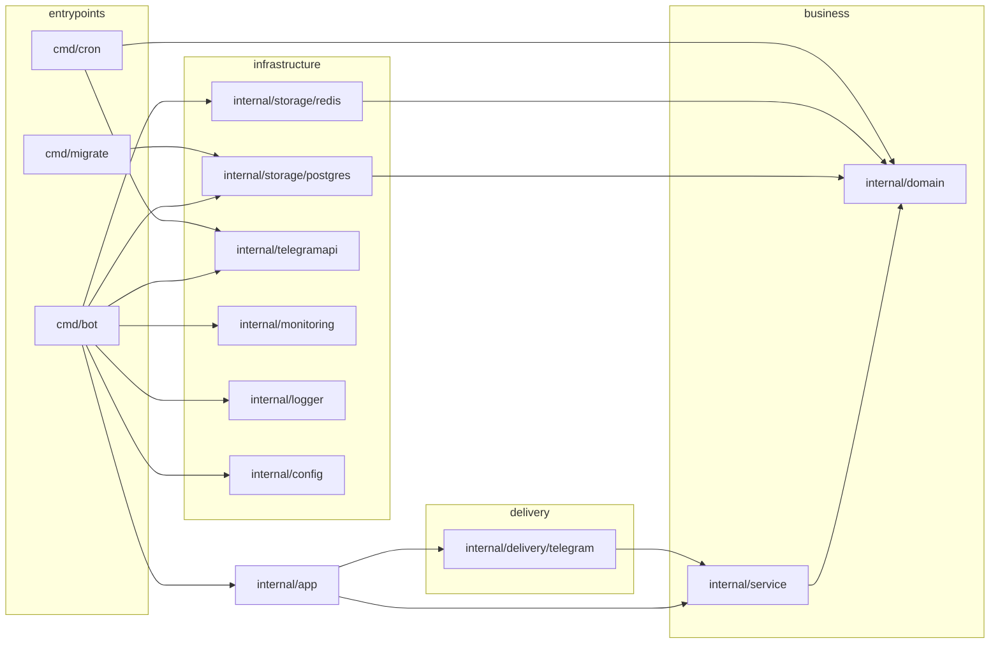
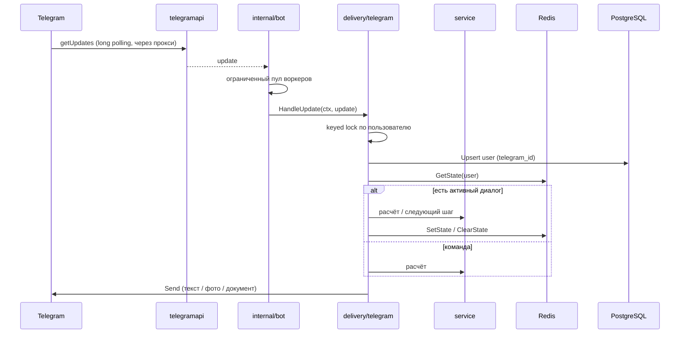
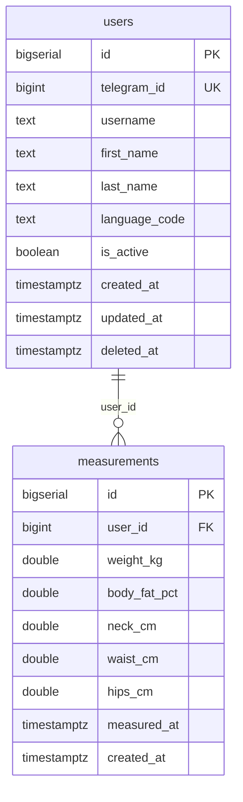

# Архитектура

Документ описывает, как устроен `mega-trainer-go`, какие у слоёв правила и как
проходит обработка одного сообщения.

## Слои и зависимости

Зависимости направлены только внутрь. `domain` не знает ни об одной инфраструктуре.

| Пакет | Ответственность | Может импортировать |
|---|---|---|
| `internal/domain` | сущности, value-объекты, интерфейсы репозиториев, sentinel-ошибки | только stdlib |
| `internal/service` | формулы, FSM-хелперы, пользователи, измерения | `domain` |
| `internal/storage/*` | реализации интерфейсов `domain` поверх PostgreSQL/Redis | `domain`, `config` |
| `internal/delivery/telegram` | разбор update, диалоги, клавиатуры, отправка | `domain`, `service`, `plot` |
| `internal/telegramapi` | клиент Bot API, HTTP(S)-прокси, удаление webhook | `config` |
| `internal/cron` | фоновые задачи (напоминания) | `domain` |
| `internal/app` | composition root: собрать зависимости и запустить бота | всё |
| `cmd/*` | тонкие entrypoints: конфиг, логгер, сигналы | `config`, `logger`, `app` |

`pkg/` намеренно отсутствует: наружу ничего не публикуется, а импорт `internal`
из `pkg` был бы нарушением направления зависимостей.

## Обработка сообщения

Ключевые решения:

- **Пул воркеров** вместо горутины на каждый update — защита от штормов и
  исчерпания ресурсов.
- **keyed lock по Telegram-ID** — сообщения одного пользователя обрабатываются
  последовательно, поэтому шаги FSM не перетирают друг друга.
- **FSM в Redis** с TTL 24 часа — бот переживает рестарт, состояние не копится
  в памяти.
- **Ошибки `Send` проверяются**; ошибка возвращается в воркер, логируется и
  инкрементирует `telegram_updates_failed_total`.

## Данные

Схема живёт только в [`migrations/`](migrations/0001_init.sql), применяется
раннером из `cmd/migrate` (см. [ADR-0003](adr/0003-embedded-sql-migrations.md)).

## Конфигурация

`configs/config.yaml` + подстановка `${ENV}`. Валидация на старте собирает все
проблемы сразу (`errors.Join`), а не падает на первой. Секреты — только из
окружения; в конфиге — ссылки на переменные.

## Наблюдаемость

- `GET /healthz` — процесс жив.
- `GET /readyz` — проверяет PostgreSQL и Redis.
- `GET /metrics` — Prometheus: обработанные/упавшие update и гистограмма времени.
- Логи — zerolog, структурированные. Формат сообщения: `[компонент:функция] описание
  на русском`, контекст — в скобках; префикс собирается через `logger.Source`.
  Токены и прокси-креденшелы не логируются.

## Фоновые задачи

`cmd/cron` — отдельный процесс: раз в `reminders.interval_hours` рассылает
активным пользователям напоминание записать вес. Ошибка доставки одному
пользователю не прерывает рассылку; ошибка чтения БД логируется, и следующий
тик повторяет попытку.

## Что осознанно не сделано (и почему)

- **Webhook-режим** — не нужен для одного инстанса; long polling проще и не
  требует публичного HTTPS. При старте webhook удаляется, чтобы не было 409.
- **ORM** — `sqlx` + явный SQL: предсказуемо, без магии и скрытых запросов.
- **Кэш графиков** — рендер PNG занимает миллисекунды, кэширование усложнило бы
  инвалидацию без пользы на текущих объёмах.
